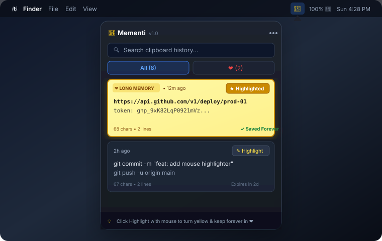

<div align="center">

# 📎 Mementi
**Ultra-lightweight macOS clipboard manager with 3-day memory & mouse yellow highlighting.**

[](#)
[](#)
[](#)
[](#)
[](https://github.com/cloudflare/security-audit-skill)
[](LICENSE)

<br/>



</div>

---

### ✨ Features

- **🪶 Ultra-Lightweight**: Native Swift 6 + AppKit. Only **~270 KB** binary, **~15 MB RAM**, and **0.0% idle CPU**.
- **🕶️ Toolbar Only**: Runs strictly in the background as an accessory app (`LSUIElement`). No Dock icon, no App Switcher clutter.
- **🕒 3-Day Default Retention**: Temporary clips are preserved for 72 hours, then quietly auto-pruned in the background without countdown clutter.
- **💛 Mouse Yellow Highlighter**: Click **Highlight** on any card with your mouse — it instantly turns **fluorescent yellow** and gets saved permanently to **Long Memory (`❤️`)**.
- **❤️ Two Clean Columns**: Instant toggle between **All** clips and **❤️** (saved Long Memory items).
- **🔒 Privacy First**: Automatically skips password managers (Apple Keychain, 1Password, KeePassXC, Bitwarden) and restricts file permissions to `0600`/`0700`.

---

### 🚀 Quick Start

```bash
git clone https://github.com/Reera-t/mementi.git
cd mementi
./build_app.sh && cp -R Mementi.app /Applications/ && open /Applications/Mementi.app
```
Look for the paperclip icon (`📎`) in your top Mac menu bar.

---

### ⌨️ How to Use

| Action | How |
| :--- | :--- |
| **Open Mementi** | Click `📎` in the top macOS menu bar |
| **Save to Long Memory** | Click the **Highlight** button with your mouse (turns yellow) |
| **Filter Favorites** | Click the **`❤️`** column tab |
| **Copy Snippet Back** | Click the copy icon (`⎘`) or double-click any card |
| **Search** | Type in the search box to filter instantly |
| **Dismiss** | Click outside or press `Esc` |

---

### 🧪 Automated Tests

```bash
swift run MementiTestRunner   # 14/14 tests pass
```

---

<div align="center">

MIT License • Created with ❤️ by [Reera Tehranizadeh](https://github.com/Reera-t)

</div>
